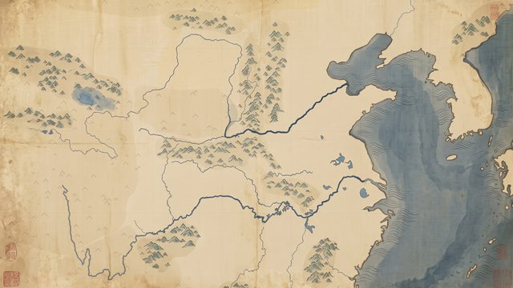
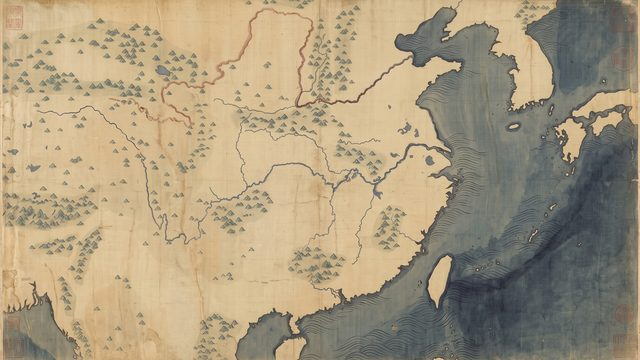

# Cartes peintes — bibliothèque partagée

Fonds de carte **sans texte**, repeints sur un guide géographique au cadrage exact d'une vue du moteur
(`{ lon, lat, k }`), réutilisables dans tous les épisodes. Le catalogue machine est `cartes.json` ; ce fichier en est la
version lisible. Mode d'emploi : skill `carte-peinte` (`.claude/skills/carte-peinte/SKILL.md`).

- `peintes/<id>.jpg` : la carte (16:9) · `guides/<id>.jpg` : son image-guide · `vignettes/<id>.jpg` : aperçu 640 px.
- Code : `remotion/src/cartes/CartePeinte.ts` · guides : composition `CartesGuides` · contrôle : `tools/verifier_carte.py`.
- Sources géographiques : Natural Earth (domaine public). Crédit à l'écran : « carte peinte d'après Natural Earth ».

## Types
| type | nom | usage |
|---|---|---|
| `soie_song` (type 1) | Carte peinte sur soie, manière Song | toute époque antique ou impériale ; soie ocre, mer en lavis bleu-gris, montagnes bleu-vert, fleuves à l'indigo |

## Cartes

### `chine_centre_nord` — Chine du Nord et plaine centrale

**Légende.** Le bassin du fleuve Jaune et la plaine centrale, du lac Qinghai à la péninsule coréenne, du coude de
l'Ordos au cours moyen du Yangzi. Cœur des royaumes Shang, Zhou, des Royaumes combattants et des Han (Chang'an,
Luoyang, Linzi, Handan, Anyang au centre du cadre).

- Type : `soie_song` · vue : lon 112,5, lat 34,2, k 52 · emprise : 94,0–131,0° E, 25,4–43,0° N · 2752 × 1536
- Contenu : côtes, îles, lacs, fleuve Jaune (cours actuel, vers le golfe du Bohai), Wei, Fen, Han, Yangzi moyen,
  reliefs (Qinling, Taihang, Yinshan) ; aucune frontière.
- Utilisée : 語 (bloc 7) — les parlers cités par Yang Xiong (方言) convergent vers Chang'an.

### `chine_centre_sud` — Chine centrale et méridionale

**Légende.** La Chine des fleuves, du fleuve Jaune à l'île de Hainan, du plateau tibétain à Taïwan et au sud du Japon.
Cadrage des dialectes chinois (mandarin, wu, gan, xiang, hakka, min, yue), de Pékin à Canton.

- Type : `soie_song` · vue : lon 112,0, lat 30,0, k 40 · emprise : 88,0–136,0° E, 18,6–41,4° N · 2752 × 1536
- Contenu : côtes, îles (Taïwan, Hainan), lacs (Dongting, Poyang, Tai), fleuve Jaune, Yangzi, rivière des Perles,
  reliefs ; aucune frontière.
- Utilisée : 語 (bloc 8) — familles de dialectes d'aujourd'hui, Pékin et Canton.
